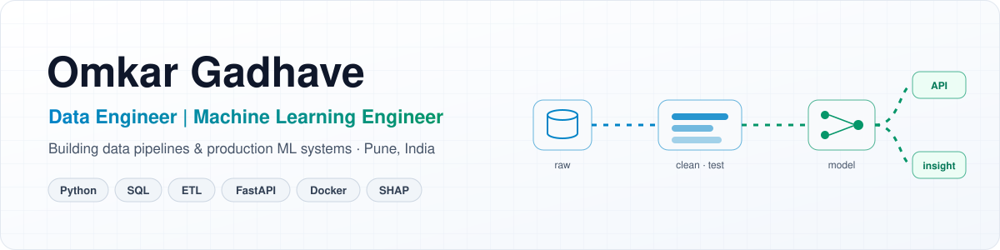
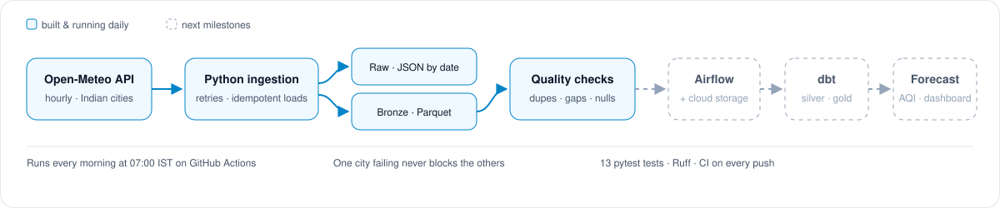

  
  

I build data platforms that don't break quietly, and ML systems people can trust in production. Four years in data, MIS and HR analytics, now shipped as tested, containerised software with CI.

---

## Shipped in public

### India Air Quality Data Platform · *data engineering*

Idempotent daily ingestion of hourly air-quality data for Indian cities into raw and bronze Parquet layers, with data-quality checks and per-city fault isolation. **[Code →](https://github.com/OmkarG-Star/india-air-quality-data-platform)**

`Python` `ETL` `Parquet` `Data Quality` `Pytest` `GitHub Actions`

### Retention Intelligence · *ML engineering*

<table>
  <tr>
    <td width="55%">
      
    </td>
    <td>
      Resignation early warning for an EPC workforce, from 7 to 180 days ahead.
        
      At 30 days, the <b>top 15% flagged catch 57% of resignations</b> (PR-AUC 0.22 against a 4.1% base rate), validated on embargoed time splits.
        
      <code>LightGBM</code> <code>SHAP</code> <code>Survival Analysis</code> <code>FastAPI</code> <code>Docker</code> <code>72 tests</code>
        
      <a href="https://retention-intelligence-b3zd.onrender.com"><b>Live demo</b></a> · <a href="https://github.com/OmkarG-Star/Retention-Intelligence">Code</a>
    </td>
  </tr>
</table>

### Resume Intelligence · *ML / NLP*

<table>
  <tr>
    <td width="55%">
      
    </td>
    <td>
      Explainable resume screening for recruiters, with per-score reasons and a four-fifths-rule fairness audit.
        
      MiniLM sentence embeddings on ONNX, so there's <b>no PyTorch at runtime</b>. Accuracy is reported on held-out sets, including the weaker one.
        
      <code>NLP</code> <code>ONNX</code> <code>FastAPI</code> <code>Docker</code> <code>57 tests</code> <code>CI</code>
        
      <a href="https://resume-intelligence-hg1g.onrender.com"><b>Live demo</b></a> · <a href="https://github.com/OmkarG-Star/AI-resume-analyzer">Code</a>
    </td>
  </tr>
</table>

Live demos run on a free plan, so the first load can take up to a minute.

<b>Earlier projects</b>

 

| Project | What it does | Stack |
|---|---|---|
| [AI Credit Risk Decision System](https://github.com/OmkarG-Star/AI-Credit-Risk-Decision-System) | Loan-default risk scoring with model comparison and SHAP explanations | XGBoost · SHAP · Streamlit |
| [Customer Segmentation Strategy](https://github.com/OmkarG-Star/AI-Customer-Segmentation-Strategy-System) | RFM + KMeans segments mapped to marketing actions | SQL · scikit-learn · Streamlit |
| [HR Analytics Dashboard](https://github.com/OmkarG-Star/HR-Analytics-Dashboard-PowerBI) | Attrition, salary and workforce insights | Power BI · DAX |

---

## How I work

- **Test on data I didn't tune on, and publish the bad numbers too.** My resume screener scored 57.9% on its second unseen set, and that number sits in the README next to the good ones.
- **Explainable by default.** Every prediction ships with the reasons behind it.
- **Production habits.** Idempotent loads, tests, CI on every push, Docker, and a live demo anyone can open without signing up.

## Stack

**Data engineering:** Python · SQL · ETL · Data Modeling · Data Quality · Parquet · DuckDB · Pandas  
**ML engineering:** LightGBM · scikit-learn · SHAP · NLP · Survival Analysis · ONNX  
**Serving & delivery:** FastAPI · REST APIs · Docker · Pytest · GitHub Actions · CI/CD  
**Analytics:** Power BI · DAX · React · TypeScript  
**Next:** Airflow · dbt · cloud object storage

---

Hiring for a Data Engineer or Machine Learning Engineer role? [Message me on LinkedIn](https://www.linkedin.com/in/omkar-gadhave-data/).
